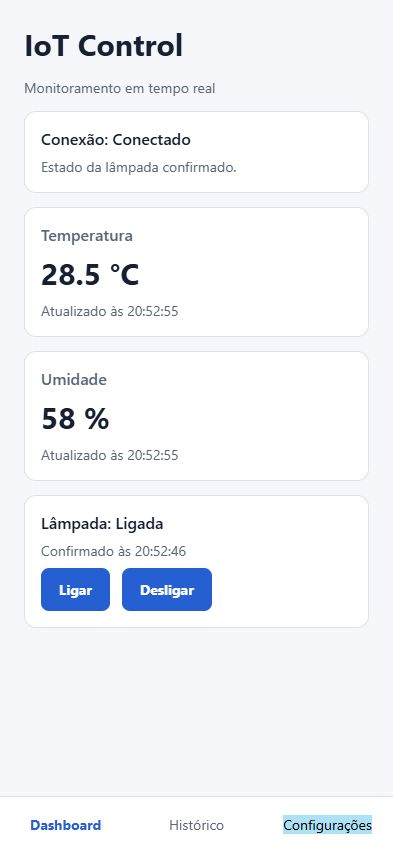
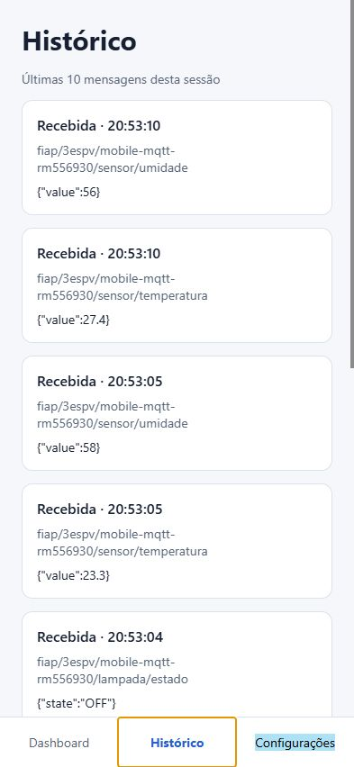
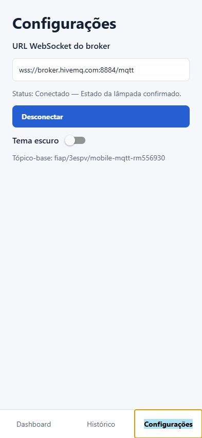
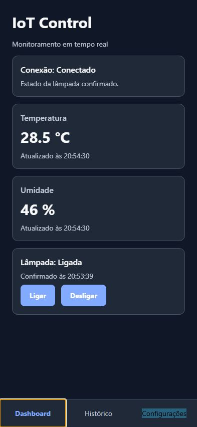
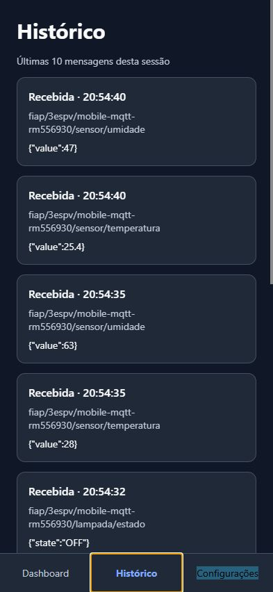
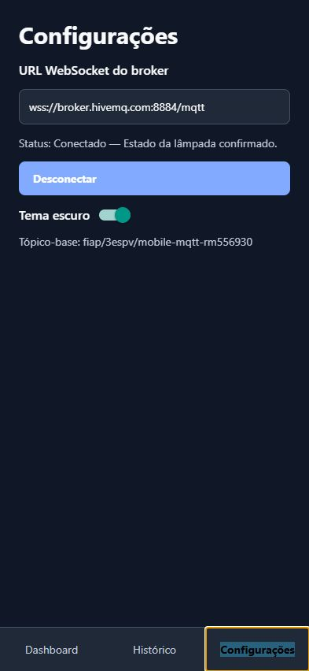

# IoT Control

Checkpoint 3 — Mobile Development & IoT. Aplicativo em React Native, Expo e TypeScript para monitorar temperatura e umidade e controlar uma lâmpada simulada via MQTT.

## Integrantes

- RM554673 — Fernanda Rocha Menon
- RM556237 — Luiza Macena Dantas
- RM558537 — Luan Ramos Garcia de Souza
- RM556930 — Matheus Ricciotti
- RM555189 — Matheus Bortolotto

## Tecnologias

Expo SDK 54, React Native 0.81, React 19, TypeScript, MQTT.js e AsyncStorage. Consulte o `package.json` para as versões declaradas.

## Instalação e execução

Requisitos: Node.js, npm, Expo Go compatível com SDK 54 ou emulador Android/iOS.

```bash
npm install
npx expo start
```

Com o emulador aberto, pressione `a` para Android ou `i` para iOS. Para Web, pressione `w`. Em outro terminal, na mesma pasta, execute o simulador:

```bash
npm run simulator
```

No aplicativo, abra **Configurações** e toque em **Conectar**. O endereço padrão é `wss://broker.hivemq.com:8884/mqtt`, MQTT sobre WebSocket seguro. É possível alterá-lo e salvá-lo ao conectar. O broker público é compartilhado e pode ficar indisponível; não envie dados sensíveis. O simulador e o aplicativo precisam usar o mesmo broker e tópico-base. Para trocar o broker do simulador no PowerShell:

```powershell
$env:MQTT_URL = 'wss://broker.hivemq.com:8884/mqtt'
npm run simulator
```

## Tópicos e mensagens

Base exclusiva do grupo: `fiap/3espv/mobile-mqtt-rm556930`.

| Sufixo | Direção no app | Exemplo |
| --- | --- | --- |
| `/sensor/temperatura` | Recebe | `{"value":24.5}` |
| `/sensor/umidade` | Recebe | `{"value":58}` |
| `/lampada/comando` | Envia | `{"action":"ON"}` ou `{"action":"OFF"}` |
| `/lampada/estado` | Recebe | `{"state":"ON"}` ou `{"state":"OFF"}` |

## Demonstração

1. Inicie o simulador e conecte o aplicativo ao mesmo broker.
2. Verifique que temperatura e umidade aparecem e mudam a cada cinco segundos.
3. Toque em **Ligar**: o simulador registra o comando, publica a confirmação e o aplicativo mostra **Ligada**.
4. Repita com **Desligar**; confira o histórico das últimas dez mensagens.
5. Em Configurações, alterne o tema e reinicie o app para verificar a persistência. A URL também é salva ao conectar.

O estado só muda após uma mensagem válida de confirmação. Mensagens inválidas aparecem no histórico, mas não alteram as leituras. Ao desconectar, comandos são recusados com aviso. O histórico é mantido somente durante a sessão. O simulador confirma o estado inicial ao conectar; como não usa mensagens retidas, se o app conectar depois, o estado aparece ao receber o próximo comando confirmado.

## Telas e evidências

Capturas reais da aplicação **Expo Web**, feitas pelo navegador durante o teste em 26/10/2026. As imagens mostram somente a aplicação, sem o desktop. Clique em cada captura para ampliá-la.

### Tema claro

<table>
<tr><th>Dashboard</th><th>Histórico</th><th>Configurações</th></tr>
<tr><td align="center"><a href="docs/evidencias/web/dashboard-claro.jpg"></a></td><td align="center"><a href="docs/evidencias/web/historico-claro.jpg"></a></td><td align="center"><a href="docs/evidencias/web/configuracoes-claro.jpg"></a></td></tr>
</table>

### Tema escuro

<table>
<tr><th>Dashboard</th><th>Histórico</th><th>Configurações</th></tr>
<tr><td align="center"><a href="docs/evidencias/web/dashboard-escuro.jpg"></a></td><td align="center"><a href="docs/evidencias/web/historico-escuro.jpg"></a></td><td align="center"><a href="docs/evidencias/web/configuracoes-escuro.jpg"></a></td></tr>
</table>

### O que foi verificado na Web

| Fluxo | Resultado observado |
| --- | --- |
| Conexão | Conectou ao broker HiveMQ via WebSocket seguro |
| Sensores | Recebeu temperatura e umidade do simulador e atualizou a tela |
| Ligar e desligar | Enviou ON/OFF e recebeu as confirmações de estado |
| Confirmação | Exibiu “Estado da lâmpada confirmado” após a resposta |
| Histórico | Registrou comandos enviados e estados recebidos; a lista contém as últimas 10 mensagens da sessão |
| Temas | Alternou entre claro e escuro nas telas |
| Reinício | Recarregar o aplicativo iniciou nova sessão desconectada, sem as leituras anteriores |

As leituras são simuladas. Os horários das novas capturas seguem o fuso do navegador; os números variam conforme as mensagens recebidas. Os prints do histórico mostram a parte visível de uma lista com rolagem.

<details>
<summary><strong>Evidências complementares no Android — Pixel 4 emulado</strong></summary>

As capturas abaixo foram fornecidas pelo grupo nos testes do Android. Elas preservam o contexto do simulador e do emulador.

| Evidência | Imagem |
| --- | --- |
| Dashboard e simulador | [Abrir captura](docs/evidencias/dashboard.png) |
| Leituras no histórico | [Abrir captura](docs/evidencias/historico.png) |
| Comando enviado e confirmação recebida | [Abrir captura](docs/evidencias/comando-historico.png) |
| Configurações | [Abrir captura](docs/evidencias/configuracoes.png) |

A captura Android de Configurações é anterior ao ajuste do texto de confirmação. Os horários seguem o fuso configurado no emulador.

</details>

### Limites da validação

- **Android:** fluxo demonstrado pelo grupo no emulador Pixel 4.
- **Web:** conexão, sensores, comandos, confirmações, histórico e alternância de tema exercitados no navegador.
- **iOS:** pacote JavaScript compilado, sem execução em dispositivo ou simulador iOS.
- A persistência da URL alterada e do tema após encerrar/reabrir o aplicativo ainda precisa de verificação específica.

## Entrega

Enviar somente o link acessível deste repositório na tarefa do Microsoft Teams. Não é necessário vídeo ou apresentação.
