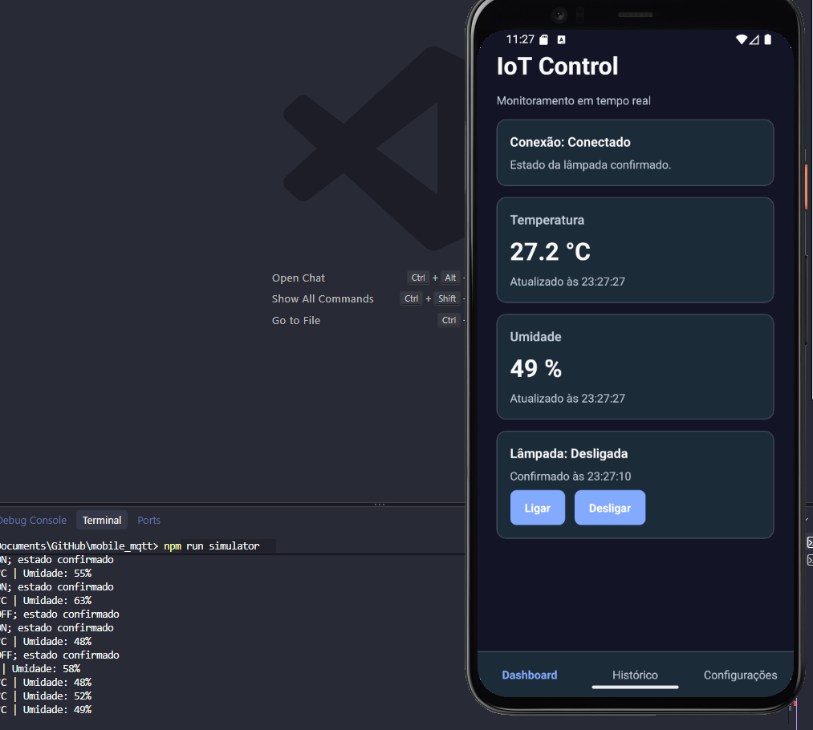
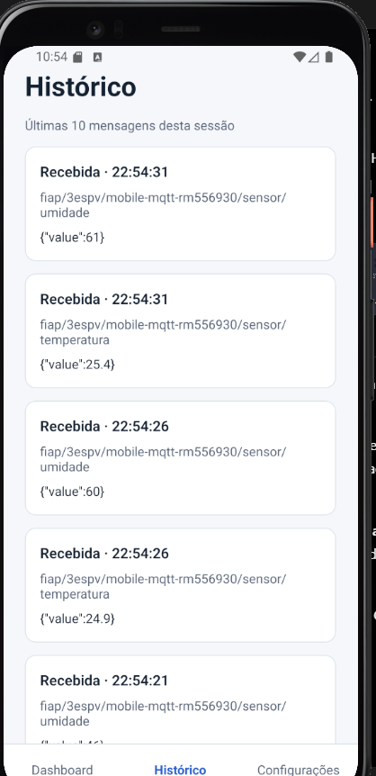
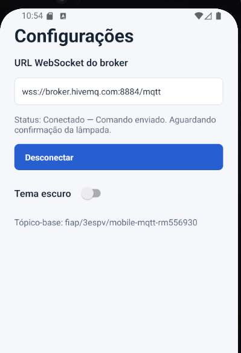
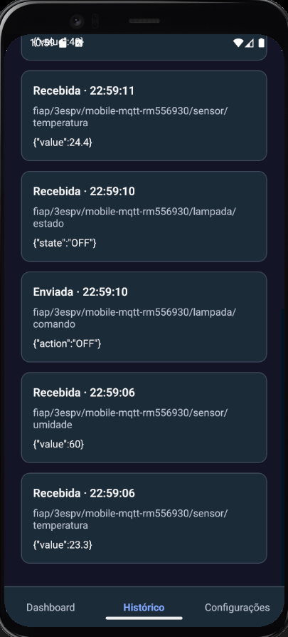

# IoT Control

Checkpoint 3 — Mobile Development & IoT. Aplicativo em React Native, Expo e TypeScript para monitorar temperatura e umidade e controlar uma lâmpada simulada via MQTT.

## Integrantes

- RM554673 — Fernanda Rocha Menon
- RM556237 — Luiza Macena Dantas
- RM558537 — Luan Ramos Garcia de Souza
- RM556930 — Matheus Ricciotti
- RM555189 — Matheus Bortolotto

## Tecnologias

Expo SDK 54, React Native 0.81, React 19, TypeScript, MQTT.js e AsyncStorage. Consulte o `package.json` para as versões declaradas.

## Instalação e execução

Requisitos: Node.js, npm, Expo Go compatível com SDK 54 ou emulador Android/iOS.

```bash
npm install
npx expo start
```

Com o emulador aberto, pressione `a` para Android ou `i` para iOS. Para Web, pressione `w`. Em outro terminal, na mesma pasta, execute o simulador:

```bash
npm run simulator
```

No aplicativo, abra **Configurações** e toque em **Conectar**. O endereço padrão é `wss://broker.hivemq.com:8884/mqtt`, MQTT sobre WebSocket seguro. É possível alterá-lo e salvá-lo ao conectar. O broker público é compartilhado e pode ficar indisponível; não envie dados sensíveis. O simulador e o aplicativo precisam usar o mesmo broker e tópico-base. Para trocar o broker do simulador no PowerShell:

```powershell
$env:MQTT_URL = 'wss://broker.hivemq.com:8884/mqtt'
npm run simulator
```

## Tópicos e mensagens

Base exclusiva do grupo: `fiap/3espv/mobile-mqtt-rm556930`.

| Sufixo | Direção no app | Exemplo |
| --- | --- | --- |
| `/sensor/temperatura` | Recebe | `{"value":24.5}` |
| `/sensor/umidade` | Recebe | `{"value":58}` |
| `/lampada/comando` | Envia | `{"action":"ON"}` ou `{"action":"OFF"}` |
| `/lampada/estado` | Recebe | `{"state":"ON"}` ou `{"state":"OFF"}` |

## Demonstração

1. Inicie o simulador e conecte o aplicativo ao mesmo broker.
2. Verifique que temperatura e umidade aparecem e mudam a cada cinco segundos.
3. Toque em **Ligar**: o simulador registra o comando, publica a confirmação e o aplicativo mostra **Ligada**.
4. Repita com **Desligar**; confira o histórico das últimas dez mensagens.
5. Em Configurações, alterne o tema e reinicie o app para verificar a persistência. A URL também é salva ao conectar.

O estado só muda após uma mensagem válida de confirmação. Mensagens inválidas aparecem no histórico, mas não alteram as leituras. Ao desconectar, comandos são recusados com aviso. O histórico é mantido somente durante a sessão. O simulador confirma o estado inicial ao conectar; como não usa mensagens retidas, se o app conectar depois, o estado aparece ao receber o próximo comando confirmado.

## Telas e evidências

Capturas reais fornecidas pelo grupo durante a execução no **Pixel 4 emulado (Android)**. Clique nas imagens para visualizar em tamanho completo.

| Tela | Funcionalidade |
| --- | --- |
| Dashboard | Conexão, temperatura, umidade, comandos e estado confirmado da lâmpada |
| Histórico | Últimas 10 mensagens da sessão, com direção, horário, tópico e conteúdo |
| Configurações | Endereço do broker, conectar/desconectar e escolha de tema |

### Dashboard e comunicação MQTT

A captura mostra o tema escuro, as leituras recebidas e a mensagem **“Estado da lâmpada confirmado”**, com o simulador em execução no terminal.

<a href="docs/evidencias/dashboard.png"></a>

### Histórico e configurações

<table>
  <tr>
    <th>Histórico de sensores</th>
    <th>Configurações da conexão</th>
  </tr>
  <tr>
    <td align="center"><a href="docs/evidencias/historico.png"></a></td>
    <td align="center"><a href="docs/evidencias/configuracoes.png"></a></td>
  </tr>
</table>

A captura de Configurações foi feita antes da correção do texto de confirmação; a versão atual já contém esse ajuste.

### Evidência de comando e resposta

O comando `{"action":"OFF"}` aparece como **Enviada**. A resposta `{"state":"OFF"}` aparece como **Recebida**, demonstrando que o aplicativo recebe o estado do simulador.

<a href="docs/evidencias/comando-historico.png"></a>

### Ambiente e limites da validação

- **Android:** fluxo demonstrado no emulador pelo grupo, incluindo sensores e comandos ON/OFF.
- **Web:** compilação verificada; estas imagens são do Android, não da versão Web.
- **iOS:** pacote JavaScript compilado, sem execução em dispositivo ou simulador iOS.
- **Horários:** as capturas usam o fuso configurado no emulador.
- **Histórico:** mantido somente durante a sessão; reiniciar o aplicativo inicia uma lista vazia.

## Entrega

Enviar somente o link acessível deste repositório na tarefa do Microsoft Teams. Não é necessário vídeo ou apresentação.
